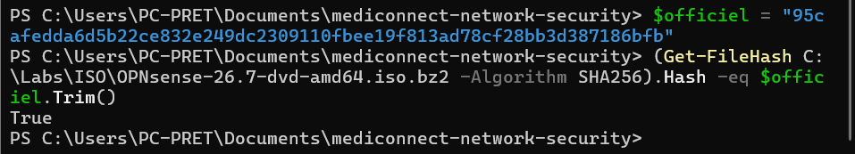
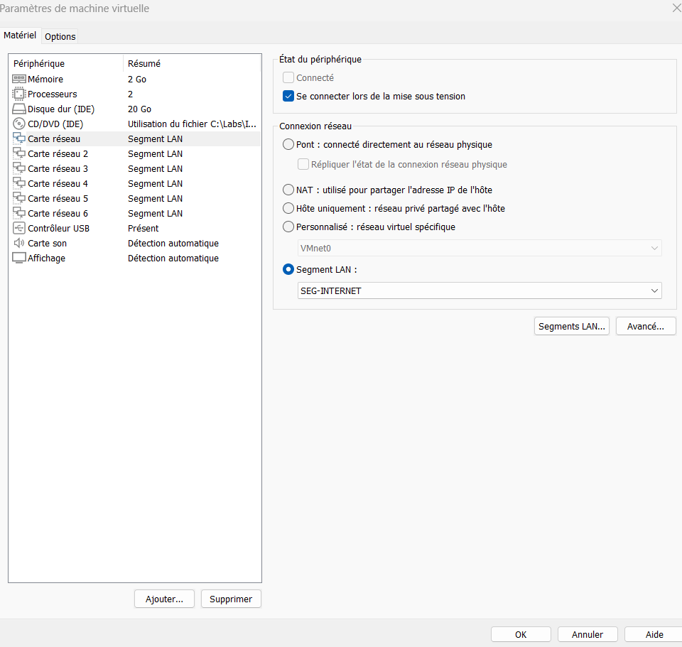
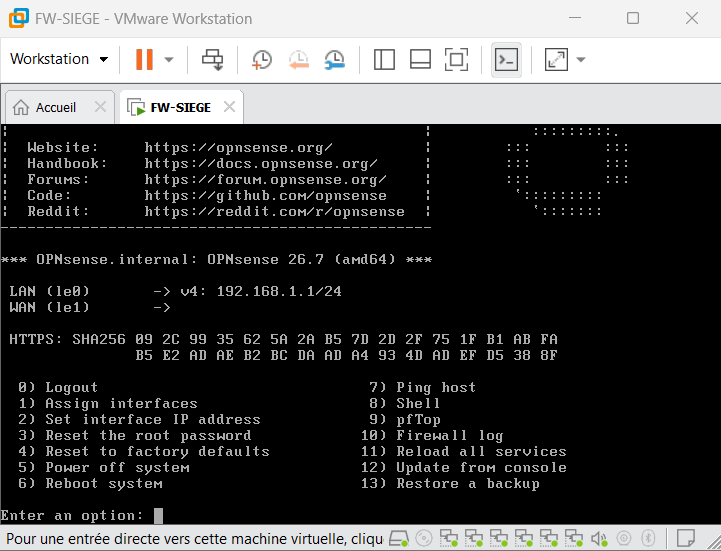
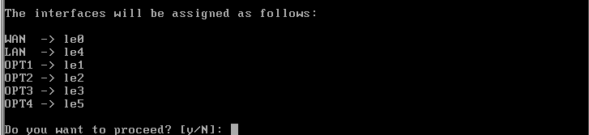
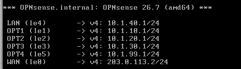
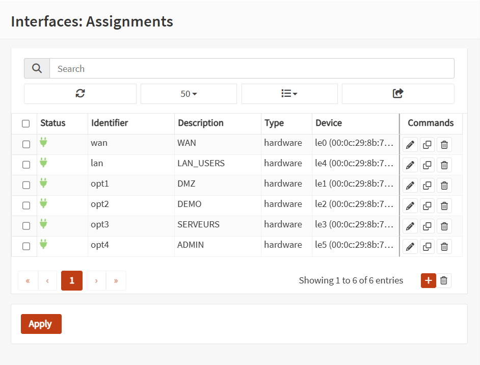
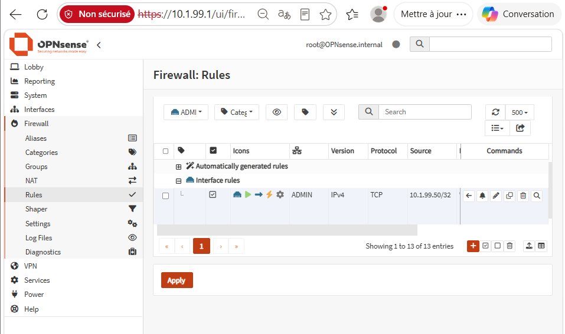
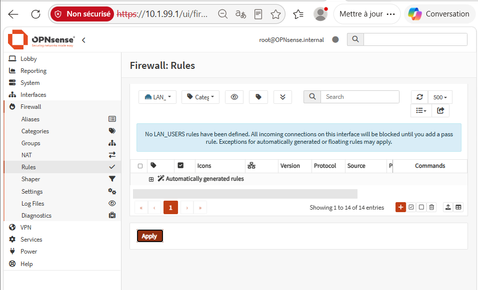
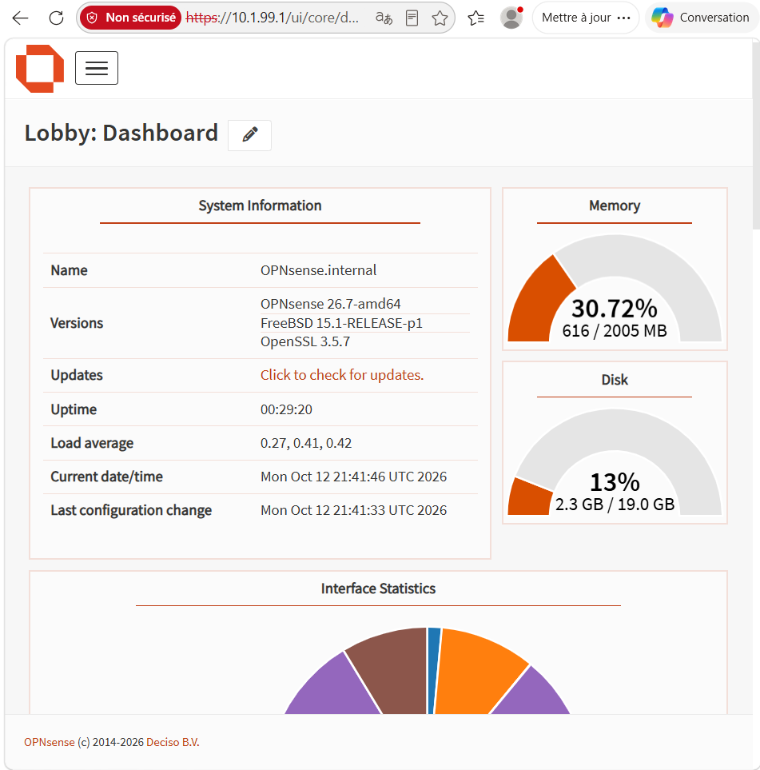
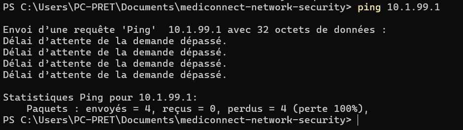

## 4. Mise en place de la topologie : pare-feu du siège

### 4.1 Environnement de virtualisation

La maquette est réalisée dans **VMware Workstation Pro 26H1** sur un poste Windows 11 (16 Go de mémoire vive). Ce choix permet de reproduire une infrastructure complète sur une seule machine, avec des réseaux virtuels isolés les uns des autres. Les pare-feu fonctionnent sous **OPNsense 26.7** (basé sur FreeBSD 15.1), une solution libre qui couvre l'ensemble des fonctions demandées par le sujet : filtrage, VPN IPsec et OpenVPN, authentification LDAP, journalisation et contrôle applicatif.

Les serveurs et les postes de test fonctionnent sous Debian, sans interface graphique pour limiter la consommation de ressources.

### 4.2 Vérification de l'intégrité du logiciel

Avant toute installation, l'image d'installation d'OPNsense a été contrôlée : son empreinte SHA-256 a été calculée localement puis comparée à celle publiée par l'éditeur sur son propre site, distinct du miroir de téléchargement. Cette vérification protège contre une image corrompue ou volontairement modifiée sur le miroir (attaque de la chaîne d'approvisionnement). Elle est particulièrement importante ici, car le pare-feu voit tout le trafic entre les zones : un pare-feu compromis annulerait l'ensemble de l'architecture.

*Capture : 03-01-verification-iso*

### 4.3 Création de la machine virtuelle du pare-feu du siège

La machine `FW-SIEGE` est dimensionnée au plus juste pour un pare-feu : 2 cœurs, 2 Go de mémoire et un disque de 20 Go.

Le réseau est construit avec des **segments LAN VMware**. Un segment LAN est un commutateur virtuel privé : seules les machines branchées sur le même segment communiquent entre elles, sans lien avec le poste hôte ni avec le réseau physique. Chaque zone de sécurité est un segment distinct, et le pare-feu est la seule machine branchée sur tous : tout flux entre deux zones traverse donc obligatoirement le pare-feu, comme le prévoit l'architecture (section 2).

| Carte | Segment | Zone |
|---|---|---|
| 1 | `SEG-INTERNET` | WAN (Internet simulé) |
| 2 | `SEG-DMZ` | DMZ |
| 3 | `SEG-DEMO` | DEMO |
| 4 | `SEG-SERVEURS` | SERVEURS |
| 5 | `SEG-LAN1` | LAN-USERS |
| 6 | VMnet2 (hôte uniquement) | ADMIN |

*Capture : 03-02-vm-cartes-reseau*

### 4.4 Installation d'OPNsense

OPNsense est installé sur le disque virtuel à partir de l'image d'installation, puis l'image est retirée du lecteur virtuel pour que la machine démarre sur le système installé. Le compte administrateur reçoit un mot de passe choisi à l'installation, différent du mot de passe par défaut du mode d'essai.

*Capture : 03-03-opnsense-installe*

### 4.5 Affectation des interfaces et adressage

Chaque carte réseau est affectée à un rôle, puis reçoit l'adresse de passerelle prévue par le plan d'adressage (section 3). La correspondance entre les cartes virtuelles et les interfaces d'OPNsense a été vérifiée en comparant leurs adresses MAC : une inversion aurait branché une zone sur le mauvais segment.

Après l'assistant de configuration initial, l'interface WAN a été contrôlée : l'assistant l'avait repassée en DHCP, et son adresse fixe `203.0.113.2/24` a dû être rétablie (voir 5.7).

| Rôle | Carte | Description | Adresse |
|---|---|---|---|
| WAN | `le0` | WAN | `203.0.113.2/24` |
| LAN | `le4` | LAN_USERS | `10.1.40.1/24` (provisoire, voir 4.8) |
| OPT1 | `le1` | DMZ | `10.1.10.1/24` |
| OPT2 | `le2` | DEMO | `10.1.20.1/24` |
| OPT3 | `le3` | SERVEURS | `10.1.30.1/24` |
| OPT4 | `le5` | ADMIN | `10.1.99.1/24` |

*Capture : 03-04-assignation-interfaces*

*Capture : 03-05-interfaces-configurees*

*Capture : 03-10-interfaces-nommees*

### 4.6 Accès d'administration

Les segments LAN étant isolés du poste hôte, l'interface web d'OPNsense n'est pas joignable depuis le poste de travail. La zone ADMIN est donc réalisée avec un réseau VMware **hôte uniquement** (VMnet2, sans service DHCP) sur lequel le poste physique reçoit l'adresse fixe `10.1.99.50`. Il joue ainsi le rôle de **poste d'administration**, situé dans le réseau d'administration dédié et non dans le réseau des utilisateurs.

Une règle de pare-feu, limitée à ce seul poste, autorise l'accès HTTPS à l'interface du pare-feu :

| Interface | Action | Protocole | Source | Destination | Port |
|---|---|---|---|---|---|
| ADMIN | Autoriser | TCP | `10.1.99.50` | Le pare-feu lui-même | 443 |

Toute autre machine qui se brancherait sur la zone ADMIN serait bloquée. Cette règle applique le principe du moindre privilège.

*Capture : 03-09-regle-admin-https*

**Suppression des règles par défaut du LAN.** À l'installation, OPNsense ajoute deux règles automatiques sur l'interface LAN : une règle qui autorise tout le trafic sortant du LAN, et une règle « anti-verrouillage » qui ouvre l'interface d'administration (HTTPS et SSH) depuis le LAN. Ces règles servent à ne pas perdre l'accès au premier démarrage, mais elles contredisent l'architecture : le LAN accueille les utilisateurs, qui ne doivent ni administrer le pare-feu ni accéder librement aux autres zones. Une fois l'accès depuis la zone ADMIN validé :

- la règle anti-verrouillage est désactivée ;
- les règles « Default allow LAN to any » (IPv4 et IPv6) sont supprimées ;
- l'interface web d'administration n'écoute plus que sur l'interface ADMIN.

Le LAN est ainsi soumis au même principe « tout interdit par défaut » que les autres zones ; ses flux légitimes seront ouverts service par service avec les VLAN.

*Capture : 03-11-regles-lan-supprimees*

Dans la maquette, le poste hôte administre directement le pare-feu. La politique cible (section 2.5) fait passer l'administration par le bastion ; ce point est traité dans la section consacrée à l'administration sécurisée.

### 4.7 Vérifications

Le comportement « tout interdit par défaut » est vérifié depuis le poste d'administration :

- la page d'administration en HTTPS s'affiche (flux autorisé) ;
- un ping vers le pare-feu échoue (flux non autorisé) : le filtrage bloque tout ce qui n'a pas été explicitement ouvert, y compris un test aussi simple que le ping.

*Capture : 03-07-dashboard-opnsense*

*Capture : 03-08-seul-https-autorise*

Un instantané de la machine virtuelle est enregistré à ce stade, ce qui permet de revenir à un état connu après une erreur de configuration.

### 4.8 Limites et points d'attention

- **Amorçage de l'accès web.** Une interface sans règle bloque tout, y compris l'accès à la page qui permet de créer une règle. Pour sortir de ce cercle, le filtrage a été désactivé depuis la console pendant la durée de la création de la règle, puis réactivé. Cette opération n'a été possible que parce que la console de la machine virtuelle est un accès d'urgence physique ; en production, la règle d'administration serait préparée avant la mise en service.
- **Poste d'administration.** Le poste physique appartient à la zone ADMIN, mais il reste connecté à d'autres réseaux (Internet, réseau local de l'hôte). Une compromission du poste hôte compromettrait donc l'administration. En production, on utiliserait un poste dédié ou un bastion, point développé dans la section sur l'administration sécurisée.
- **Adresse du LAN provisoire.** Le plan prévoit un VLAN par service au sein du LAN-USERS ; l'interface LAN porte pour l'instant une adresse provisoire, remplacée lors de la mise en place des VLAN.
- **Cartes réseau émulées.** VMware présente à OPNsense des cartes de type AMD PCnet (`le`), suffisantes pour une maquette mais plus lentes que des cartes de production.
- **Internet simulé.** Les deux pare-feu partageront un seul segment WAN : il simule Internet sans reproduire deux opérateurs distincts ni de véritables adresses publiques.
