## 5. VPN site-à-site IPsec

### 5.1 Besoin et choix techniques

Le site secondaire doit accéder à certaines ressources du siège à travers Internet, un réseau que l'entreprise ne maîtrise pas. Le sujet impose un VPN IPsec site-à-site entre les deux pare-feu : le trafic entre les sites est chiffré et authentifié, et un attaquant placé sur Internet ne voit que des paquets chiffrés.

| Choix | Justification |
|---|---|
| **IKEv2** | Version actuelle du protocole d'échange de clés : plus simple, plus robuste et plus sûre qu'IKEv1 |
| **Mode route-based (interface virtuelle VTI)** | Le tunnel apparaît comme une interface réseau (`ipsec1`). Le trafic qui en sort est filtré par des règles dédiées, comme celui de n'importe quelle zone, et ajouter un réseau ne demande qu'une route, pas une nouvelle négociation |
| **Authentification par clé pré-partagée** | Simple à mettre en œuvre dans la maquette ; les certificats sont recommandés en production (voir 5.8) |
| **Le siège initie, le site secondaire répond** | Le siège démarre le tunnel ; le site secondaire attend l'appel, ce qui évite deux négociations simultanées |

### 5.2 Mise en place du pare-feu du site secondaire

La machine `FW-SITE2` reprend la démarche du siège (section 4) : installation d'OPNsense 26.7, mot de passe administrateur distinct de celui du siège, et trois interfaces.

| Interface | Carte | Segment | Adresse |
|---|---|---|---|
| WAN | `le0` | `SEG-INTERNET` (partagé avec le siège) | `203.0.113.3/24` |
| LAN | `le1` | `SEG-LAN2` | `10.2.40.1/24` (provisoire, avant les VLAN) |
| ADMIN_SITE2 | `le2` | VMnet3 (hôte uniquement) | `10.2.99.1/24` |

Le site secondaire reçoit le même durcissement que le siège :

- l'interface web n'est accessible que depuis le poste d'administration (`10.2.99.50`), en HTTPS, et n'écoute que sur l'interface ADMIN_SITE2 ;
- les règles automatiques du LAN (« tout autoriser » et anti-verrouillage) sont supprimées : le LAN est soumis au principe « tout interdit par défaut ».

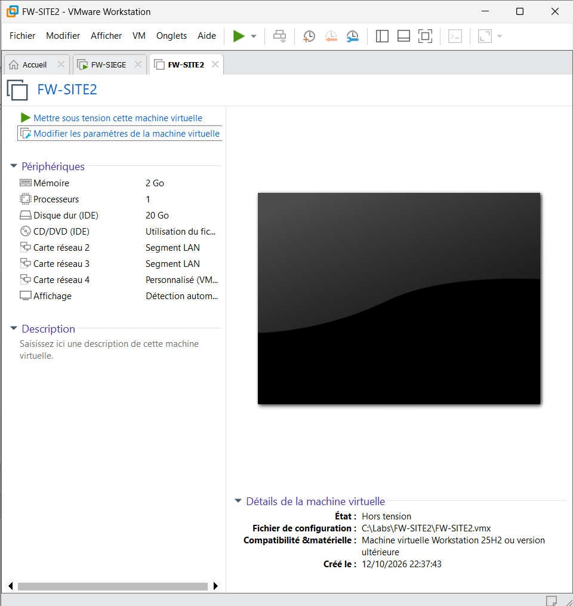
*Capture : machine virtuelle FW-SITE2 et ses trois cartes réseau*

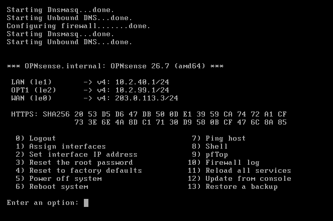
*Capture : interfaces et adresses de FW-SITE2*

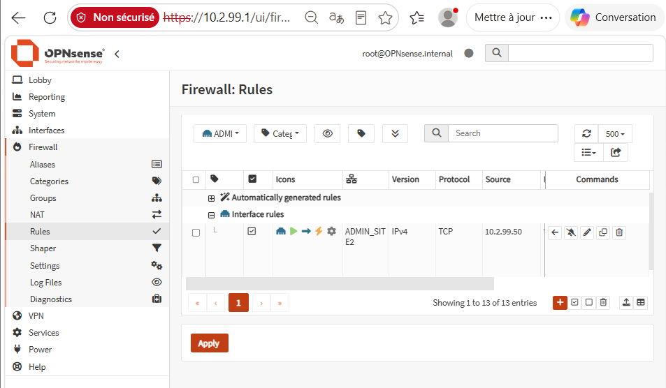
*Capture : règle d'accès d'administration limitée au poste 10.2.99.50*

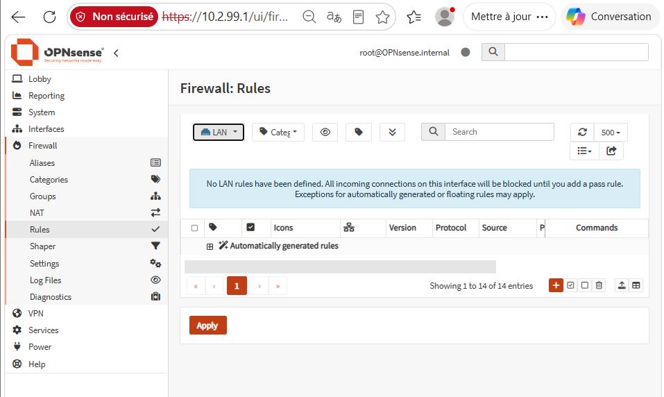
*Capture : aucune règle sur le LAN, tout est interdit par défaut*

### 5.3 Ouverture du WAN au seul pair

Chaque pare-feu bloque par défaut tout ce qui arrive d'Internet. Trois flux sont ouverts, et **uniquement depuis l'adresse de l'autre pare-feu** : un tiers sur Internet ne peut pas engager de négociation IPsec.

| Pare-feu | Protocole | Port | Source autorisée | Rôle |
|---|---|---|---|---|
| FW-SIEGE | UDP | 500 | `203.0.113.3` | IKE : authentification et négociation des clés |
| FW-SIEGE | UDP | 4500 | `203.0.113.3` | IKE et ESP encapsulés en cas de traduction d'adresses |
| FW-SIEGE | ESP | — | `203.0.113.3` | Données chiffrées du tunnel |
| FW-SITE2 | idem | idem | `203.0.113.2` | Règles symétriques |

Le blocage des réseaux « bogon » a été désactivé sur les deux WAN : la plage `203.0.113.0/24` est réservée à la documentation et figure dans cette liste. Cette exception est propre à la maquette (voir 5.8).

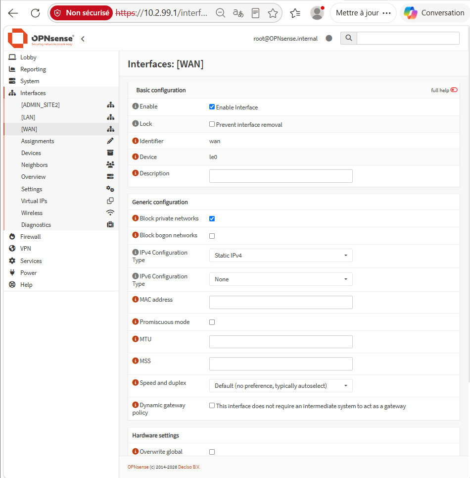
*Capture : blocage des réseaux bogon désactivé sur le WAN*

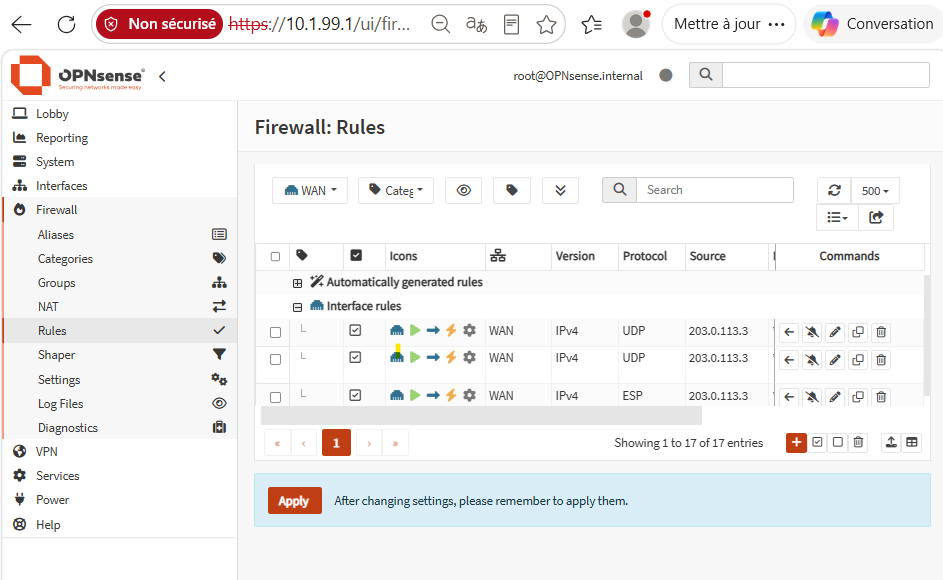
*Capture : les trois règles WAN de FW-SIEGE, limitées à l'adresse du site secondaire*

### 5.4 Paramètres du tunnel

| Élément | Valeur |
|---|---|
| Version | IKEv2 |
| Identifiants | Adresse WAN de chaque pare-feu (`203.0.113.2` et `203.0.113.3`) |
| Clé pré-partagée | 32 caractères aléatoires, conservée hors du dépôt de code |
| Algorithmes IKE négociés | AES-CBC-128, HMAC-SHA2-256, échange de clés ECP-256 (courbe elliptique) |
| Algorithmes ESP négociés | AES-GCM-128 (chiffrement et intégrité), ECP-256 (confidentialité persistante) |
| Détection de pair mort (DPD) | 10 secondes |
| MOBIKE | Désactivé (adresses fixes entre deux sites) |
| Sélecteurs de trafic | `0.0.0.0/0` des deux côtés, mode tunnel |
| Politiques IPsec | **Désactivées** : le trafic n'entre dans le tunnel que par routage vers `ipsec1` |
| Request ID | `1`, identique dans le tunnel et dans l'interface virtuelle |
| Interface virtuelle | `ipsec1` : siège `10.255.0.1`, site secondaire `10.255.0.2`, masque `/30` |

Les sélecteurs `0.0.0.0/0` signifient que le tunnel accepte tout trafic ; c'est le routage et le pare-feu qui décident de ce qui y entre et de ce qui en sort. Ce fonctionnement n'est correct que si les politiques IPsec sont désactivées (voir 5.7).

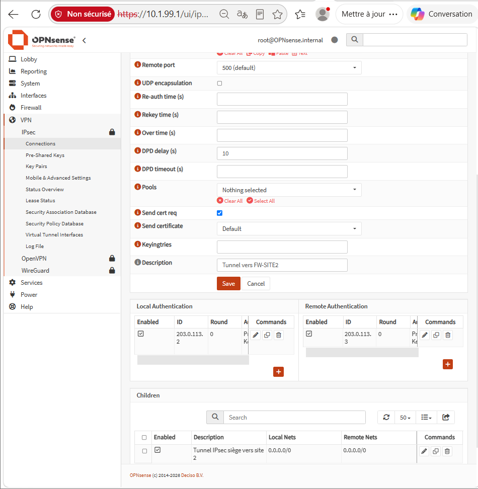
*Capture : connexion IPsec du siège (sans la clé)*

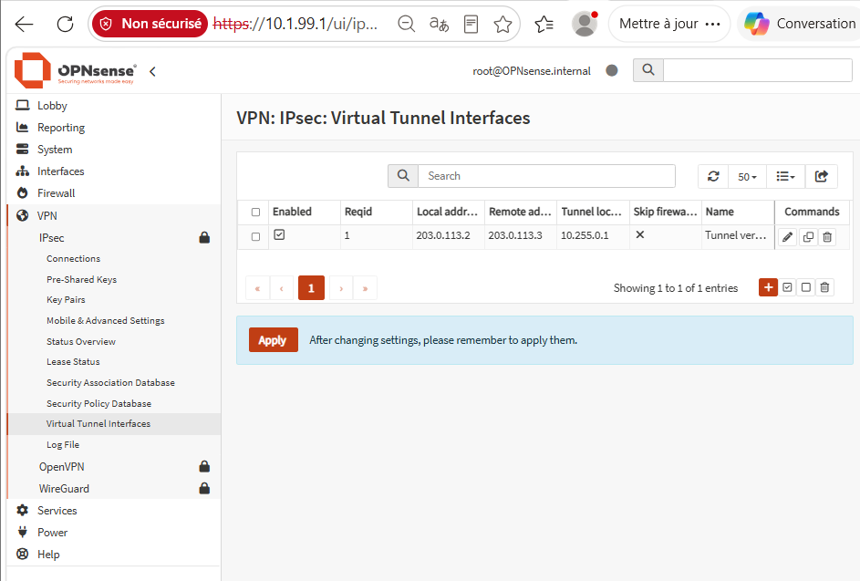
*Capture : interface virtuelle du tunnel*

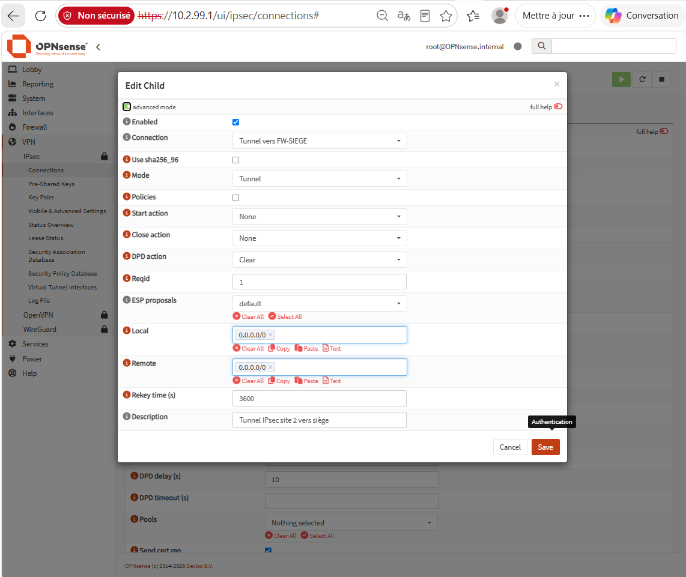
*Capture : politiques IPsec désactivées dans le tunnel*

### 5.5 Filtrage du trafic du tunnel

Le tunnel n'est pas une zone de confiance : le trafic qui en sort est filtré comme celui de n'importe quelle interface, et rien n'est autorisé par défaut. Pour valider le tunnel, une seule règle de test est ouverte sur le site secondaire :

| Interface | Action | Protocole | Source | Destination |
|---|---|---|---|---|
| IPsec (FW-SITE2) | Autoriser | ICMP | `10.255.0.1` | `10.255.0.2` |

Les règles définitives (par exemple, les VLAN du site secondaire vers certains serveurs du siège) sont décrites dans la section consacrée à la politique de filtrage.

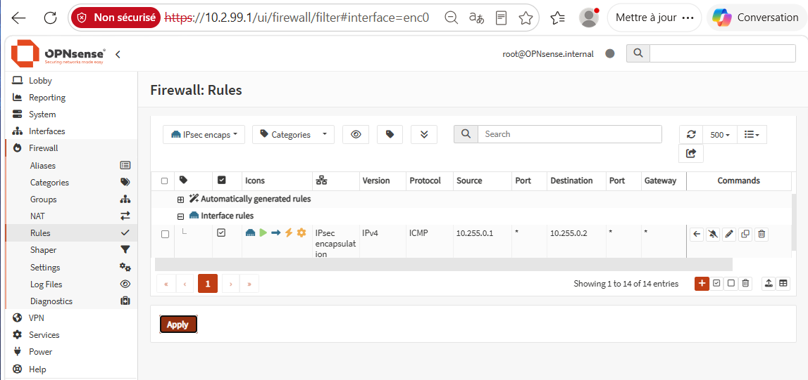
*Capture : règle de test sur l'interface IPsec du site secondaire*

### 5.6 Vérifications

- **Phase 1 établie** (`ESTABLISHED`) : les deux pare-feu se sont authentifiés mutuellement.
- **Phase 2 installée** (`INSTALLED`) : le tunnel de données est actif, avec des compteurs d'octets dans les deux sens.
- **Ping de `10.255.0.1` vers `10.255.0.2` réussi**, avec le filtrage actif sur les deux pare-feu.
- **Accès d'administration conservé** sur les deux pare-feu pendant que le tunnel est actif.

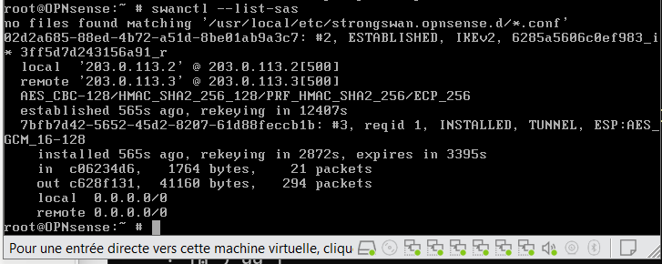
*Capture : phases 1 et 2 établies*

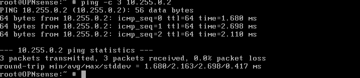
*Capture : ping à travers le tunnel chiffré*

### 5.7 Difficultés rencontrées et diagnostic

La mise en service a révélé trois problèmes, résolus en vérifiant le réseau couche par couche plutôt qu'en modifiant la configuration au hasard.

1. **Absence de communication entre les WAN.** La négociation IPsec n'aboutissait pas. Une table ARP incomplète sur FW-SITE2 (`arp -a`), puis une capture `tcpdump` sur le WAN du siège ont montré que ce dernier envoyait des requêtes DHCP : l'assistant de configuration initial avait remplacé l'adresse fixe par le mode DHCP. L'adresse `203.0.113.2/24` a été rétablie, ce qui a été vérifié avec `ifconfig`.
2. **Perte de l'accès d'administration lorsque le tunnel était actif.** Avec des sélecteurs `0.0.0.0/0`, les politiques IPsec installées par défaut envoyaient **tout** le trafic du pare-feu dans le tunnel, y compris les réponses au poste d'administration. La désactivation des politiques a rétabli un fonctionnement purement route-based : seul le trafic routé vers `ipsec1` est chiffré.
3. **Ping sans réponse malgré un tunnel établi.** Un test de quelques secondes, filtrage désactivé sur FW-SITE2 (`pfctl -d`, puis immédiatement `pfctl -e`), a montré que le tunnel fonctionnait et que le pare-feu rejetait le trafic du tunnel faute de règle. C'est le comportement attendu du principe « tout interdit par défaut », corrigé par une règle limitée au seul flux de test.

### 5.8 Limites

- **Clé pré-partagée.** Sa compromission permettrait d'usurper un pare-feu. En production, une authentification par certificats, émis par une autorité interne, éviterait de stocker et de transmettre un secret commun.
- **Algorithmes négociés par défaut.** Les propositions par défaut ont abouti à AES-128 et ECP-256, solides aujourd'hui. Fixer explicitement AES-256-GCM et une courbe plus robuste renforcerait la configuration et empêcherait toute négociation vers un algorithme plus faible.
- **Internet simulé.** Les deux pare-feu partagent un seul segment WAN dont les adresses appartiennent à une plage de documentation ; le filtrage des réseaux bogon a dû être désactivé, ce qui ne serait pas le cas avec de vraies adresses publiques.
- **Un seul tunnel, sans redondance.** La perte d'un lien Internet coupe l'interconnexion ; un second accès ou un second tunnel serait nécessaire en production.
- **Administration du site secondaire.** Elle passe par un réseau d'administration dédié (VMnet3) relié au poste hôte, et non à travers le tunnel depuis la zone ADMIN du siège comme le prévoit l'architecture cible.
